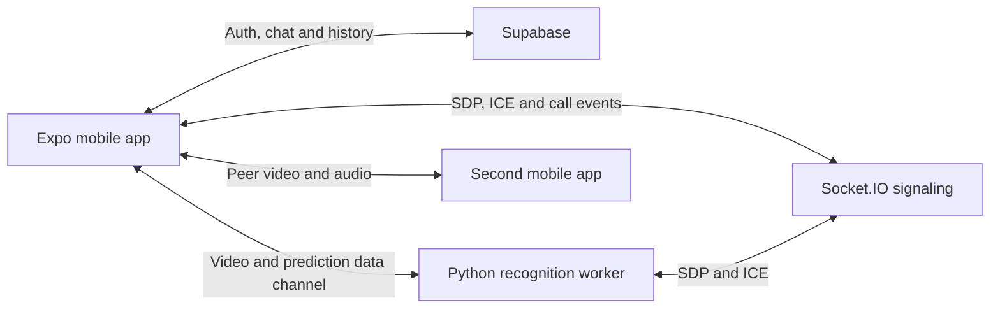

# Handibur

An Expo / React Native prototype for video calls with sign-recognition assistance.
The app includes sign-in, friends, text chats and call history backed by Supabase.
WebRTC connects callers and a Python recognition worker; the worker processes
hand landmarks and returns predicted labels over a data channel.

This repository contains the application and service code. It does **not** include
the trained model, label encoder, Supabase schema or a verified running service.
A fresh clone can run the checks below, but cannot reproduce recognition or a
complete call without those external pieces. No recognition accuracy is claimed.

## Architecture



| Location | Responsibility |
| --- | --- |
| `app/` | Expo Router screens for authentication, friends, chats, calls and settings |
| `context/auth.tsx`, `context/supabaseClient.tsx` | Supabase session and client setup |
| `context/WebRTCContext.tsx`, `context/webrtcManager.ts` | Socket.IO events, camera/audio streams and two peer connections |
| `servers/signaling/signaler.js` | Signaling on port 8080, path `/io/webrtc`, namespace `/webrtcPeer`; assigns available recognition workers |
| `servers/agent/aiserver.py` | aiortc video processing, MediaPipe landmarks and a TensorFlow/Keras model using a 40-frame window |
| `servers/agent/manager.py` | Starts five recognition processes and restarts exited processes |
| `servers/turn/` | Coturn/Terraform infrastructure examples; the mobile peer configuration currently uses STUN servers |

## Install and check the app

The app retains Expo SDK 51 and React Native 0.74.3. Use Node **22.23.3**
(`.nvmrc`) and npm 10; the npm lockfile is the reproducible install source.

```sh
git clone https://github.com/nirtuttnauer/Handibur.git
cd Handibur
# If you use nvm:
nvm use
npm ci
cp .env.example .env
```

Set the following in your local `.env`:

- `EXPO_PUBLIC_SUPABASE_URL`: your own Supabase project URL.
- `EXPO_PUBLIC_SUPABASE_ANON_KEY`: its public anonymous key. This ships to the
  client; never put a service-role key here.
- `EXPO_PUBLIC_SIGNALING_URL`: your signaling server's base URL. A physical phone
  needs a reachable development-machine LAN address, not its own `localhost`.

The app queries `user_profiles`, `friends`, `friend_requests`, `chat_rooms`,
`messages` and `call_history`, and subscribes to message changes. Database
migrations, table definitions, Realtime configuration and access policies are
not committed; obtain the original setup or implement and review your own.

For checks that need no real Supabase account or model:

```sh
npm run test:ci
EXPO_PUBLIC_SUPABASE_URL=https://example.supabase.co \
EXPO_PUBLIC_SUPABASE_ANON_KEY=not-a-real-key \
npx expo export --platform android --output-dir dist
```

The export produces JavaScript/assets; it is not a native Android build or a
call test. The existing Jest suite is one styled-text snapshot, not coverage of
authentication, chat, calls or recognition. CI runs that snapshot, the Android
export, local signaling smoke test and JavaScript/Python syntax checks.

## Run the signaling service locally

```sh
cd servers/signaling
npm ci
npm start
```

It listens on port **8080**. Keep it running in a separate terminal. The app and
Python worker must point to the same base URL; both retain a historical fallback
endpoint when the new environment variable is absent, so configure it explicitly.
The server forwards peer messages using the supplied handshake `userID` and
`role`; it does not verify Supabase tokens. Use it as a local development service
until authentication and authorization are implemented.

From the repository root, with port 8080 free:

```sh
npm run test:signaling
```

This starts and stops a local server, registers two test peers and verifies an
SDP offer is relayed. It does not connect to an external signaling service.

## Native app development

Camera/WebRTC features need a native build with the WebRTC module. They cannot
run in stock Expo Go. Follow the library's [Expo integration instructions](https://github.com/react-native-webrtc/react-native-webrtc)
for a development client/config plugin compatible with **SDK 51**, plus its
platform setup. Those development-client/plugin dependencies are not currently
configured in this repository; do not install the latest plugin blindly.

The existing local build commands are `npm run android` and `npm run ios`
(`device` / `device-ios` target connected devices). Android requires an Android
SDK; iOS requires macOS/Xcode and native dependencies. Generated `android/` and
`ios/` directories are ignored. The existing native identifiers and EAS owner
are preserved; no cloud build or deployment is part of these instructions.
Native builds and two-device calls have not been verified by the checks above.

## Recognition worker

The worker requires Python and the packages in `servers/agent/req.txt`, including
TensorFlow 2.17.0 and Keras 3.4.1. Use a compatible Python environment; Python
3.11 is a starting point for those pinned versions. Other Python dependencies
are unpinned, so this is not a fully locked inference environment.

Before starting it, obtain the matching original artifacts and put both in
`servers/agent/`:

- `model_aug.keras`
- `combined_label_encoder_2.npy` (class order must match the model)

Then, from that directory:

```sh
python3.11 -m venv .venv
source .venv/bin/activate
python -m pip install -r req.txt
cp .env.example .env
# Set your own SIGNALING_URL and TURN/STUN values in .env.
python aiserver.py
```

Start with one worker. `python manager.py` starts five processes, each loading
its own model; it expects the working directory above. TURN credentials in the
example are placeholders. The historical defaults in the worker must not be
relied on as your infrastructure. Model loading, inference quality and network
traversal remain unverified without the matching artifacts and a device test.

## Known follow-up work

`npx tsc --noEmit` currently fails on existing screen/prop types and WebRTC type
mismatches. It is not a passing CI gate. The old `.maestro/flow.yaml` also uses an
app ID that differs from `app.json` and requires an account; it is not a verified
end-to-end test. Account deletion calls Supabase's admin API from the client and
needs a server-side implementation rather than a service-role client key.

## Credits and reuse

The project history credits **Nir Tuttnauer**, **Eyal Pasha** and **Veviks**.
See the [contributors and original history](https://github.com/nirtuttnauer/Handibur/graphs/contributors).
This documentation preserves their application and service design. No project
license file is included; contact the authors for reuse terms.
